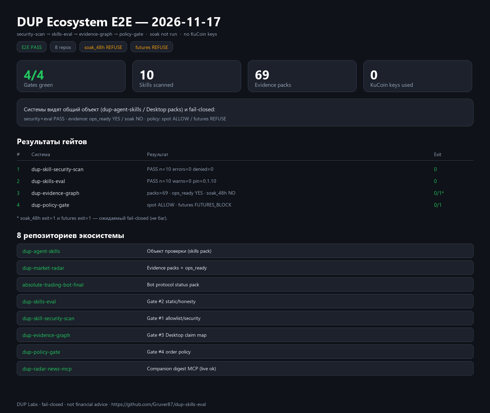

# DUP Skills Eval

[](https://github.com/Gruver87/dup-skills-eval/actions/workflows/ci.yml)

**Org:** [DUP Labs](https://github.com/Gruver87) · **Author:** Uladzimir Dabranski  
**Version:** `0.1.1` · **Fail-closed** industrial gate for [Agent Skills](https://agentskills.io/specification) packs

Evaluates a skills pack with three deterministic gates:

1. **Static** — naming, frontmatter, version pin, `.agents` mirror  
2. **Security** — secret heuristics, download-and-execute patterns  
3. **Honesty** — obsolete repo URLs, soak/futures claim hygiene, no-futures policy  

PASS = zero **errors**. Warnings do not fail. This is **not** a live-agent scorecard and **not** a 48h soak.

## Ecosystem E2E (2026-11-17)

Fail-closed chain: **security-scan → skills-eval → evidence-graph → policy-gate**.  
Result: **E2E PASS** (soak not run; no KuCoin keys). Futures correctly **REFUSED**.



- PNG: [`docs/assets/e2e-ecosystem-2026-11-17.png`](docs/assets/e2e-ecosystem-2026-11-17.png)
- PDF: [`docs/assets/e2e-ecosystem-2026-11-17.pdf`](docs/assets/e2e-ecosystem-2026-11-17.pdf)
- Regenerate: `python scripts/render_e2e_dashboard.py`

| Repo | Role |
|------|------|
| [`dup-agent-skills`](https://github.com/Gruver87/dup-agent-skills) | Primary pack under test |
| [`dup-skill-security-scan`](https://github.com/Gruver87/dup-skill-security-scan) | Install allowlist + threat heuristics |
| [`dup-market-radar`](https://github.com/Gruver87/dup-market-radar) | Ops API companions |
| [`dup-policy-gate`](https://github.com/Gruver87/dup-policy-gate) | Spot-only policy before orders |
| [`dup-evidence-graph`](https://github.com/Gruver87/dup-evidence-graph) | Desktop evidence / claim map |
| [`dup-radar-news-mcp`](https://github.com/Gruver87/dup-radar-news-mcp) | Read-only digest MCP |
| [`dup-protocol`](https://github.com/Gruver87/dup-protocol) | L1 industrial pin |

## Install

```powershell
cd C:\Users\vovun\Desktop\dup-skills-eval
python -m pip install -e ".[dev]"
.\scripts\test_all.ps1
```

## Eval sibling pack

```powershell
.\scripts\eval_dup_agent_skills.ps1
# or:
python -m skills_eval ..\dup-agent-skills --report-dir .\reports\dup-agent-skills
```

## CLI

```text
dup-skills-eval <pack_root> [--report-dir DIR] [--skip-security] [--skip-honesty]
```

Exit codes: `0` PASS · `1` FAIL (errors) · `2` bad args/path.

## Docs

- [`docs/ARCHITECTURE.md`](docs/ARCHITECTURE.md)
- [`docs/DISCLAIMER.md`](docs/DISCLAIMER.md)
- [`docs/CHANGELOG.md`](docs/CHANGELOG.md)

## License

MIT — [`LICENSE`](LICENSE).
